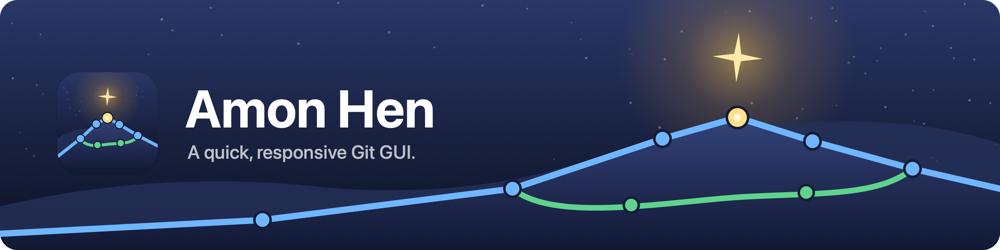

<h1></h1>

[](https://github.com/fukusaka/amonhen/actions/workflows/ci.yml)
[](https://github.com/fukusaka/amonhen/releases/latest)
[](#license)

[日本語](README.ja.md)

The Git GUI I wanted to use, so I'm building it myself. What matters most: no waiting, even on large repositories.

- History: a list with a graph, commit search, commit editing (message, squash, reorder and more), cherry-pick and revert.
- Working Copy: line-by-line staging and discarding of diffs, and a 3-pane merge editor.
- Rewriting history, discarding changes, dropping stashes and the like can all be reverted with Undo.
- The same engine is also usable from the CLI (`amonhen`) and the VSCode extension, and repositories on SSH hosts work
  just like local ones. A shared daemon keeps History, the search index and SSH connections alive, shared by the app,
  the CLI and the extension.

> [!WARNING]
> Work in progress. Features, file formats and commands may change without notice. It is provided as is, without
> warranty of any kind (see [License](#license)); keep backups of repositories that matter to you.

## Requirements

- App: macOS 14.4 or later, Apple silicon (arm64).
- Engine (CLI and daemon): macOS arm64, Linux x86_64 and aarch64 (statically linked against musl, so it runs on any
  Linux), Windows x86_64 and aarch64.
- All of them use `git` (writes and some reads launch `git`).

## Installation

Everything is on the [Releases](https://github.com/fukusaka/amonhen/releases) page. Pick one of:

- **Stable**: the release tagged `v<version>` (the VSCode extension has its own `vscode-v<version>`).
- **Snapshot**: the `snapshot` pre-release, rebuilt whenever CI passes on main.

> [!NOTE]
> Stable releases are signed and notarized from `v0.1.1`. Snapshots are signed but not notarized: install them with the
> script below, or after a browser download allow them once in System Settings > Privacy & Security. There is no stable
> VSCode extension yet, so use the snapshot for it.

### App (macOS)

1. Download `Amon-Hen-<version>.zip` (snapshot: `Amon-Hen-Snapshot-<version>.zip`).
2. Unzip it and move `Amon Hen.app` to `/Applications`. The snapshot is `Amon Hen Snapshot.app` and can sit next to the
   stable release.
3. Open it. A stable release is signed and notarized, so it opens without warnings.

On first launch the app also installs the engine (CLI and daemon), so `amonhen` is available from
`~/.local/bin/amonhen`.

### Engine only (CLI and daemon)

For Linux, Windows, or a Mac without the app.

macOS and Linux: download `amonhen-<version>-<os>-<cpu>.tar.gz` (or use `scripts/install-engine.sh`, see below), then

```sh
tar xzf amonhen-<version>-linux-x86_64.tar.gz
./amonhen install    # puts it in ~/.local/share/amonhen and links ~/.local/bin/amonhen
```

Windows: download `amonhen-<version>-windows-<cpu>.zip`, extract it, then

```powershell
.\amonhen.exe install    # puts it in %LOCALAPPDATA%\amonhen
```

and add `%LOCALAPPDATA%\amonhen\bin` to `PATH`.

### VSCode extension

1. Download `amonhen-vscode-<version>.vsix`.
2. Install it:

   ```sh
   code --install-extension amonhen-vscode-<version>.vsix
   ```

3. Reload the window. With Remote-SSH, run the command in the integrated terminal of the connected window so it is
   installed on the SSH host.

The extension bundles the engine, so nothing else is needed.

### Verifying a download

Each file carries a build provenance attestation:

```sh
gh attestation verify <file> --repo fukusaka/amonhen
```

### Shortcut: install scripts

These find the latest release, download it and install (or replace) it in one step. Only `curl` is needed. Without a
clone:

```sh
# App (macOS)
curl -fsSL https://raw.githubusercontent.com/fukusaka/amonhen/main/scripts/install-app.sh | sh -s -- stable
# Engine only (macOS, Linux)
curl -fsSL https://raw.githubusercontent.com/fukusaka/amonhen/main/scripts/install-engine.sh | sh -s -- snapshot
# VSCode extension
curl -fsSL https://raw.githubusercontent.com/fukusaka/amonhen/main/scripts/install-vscode.sh | sh -s -- snapshot
```

Use `stable` or `snapshot` as the argument. From a clone, run `scripts/install-app.sh`,
`scripts/install-engine.sh` and `scripts/install-vscode.sh` directly. Running them again updates what is installed; if
the app is running, `install-app.sh` says so, and the new version takes effect when you reopen it.

## Documents

- [Usage](docs/usage.md): app, SSH hosts, shared daemon, CLI
- [VSCode extension](apps/vscode) and its [design](docs/vscode.md)
- [Design](docs/design.md) and [front API contract](docs/front.md)
- [Development](docs/development.md) and [Release](docs/release.md)
- [Changelog](CHANGELOG.md)

## License

Use it under your choice of [MIT](LICENSE-MIT) or [Apache License 2.0](LICENSE-APACHE) (`MIT OR Apache-2.0`).
