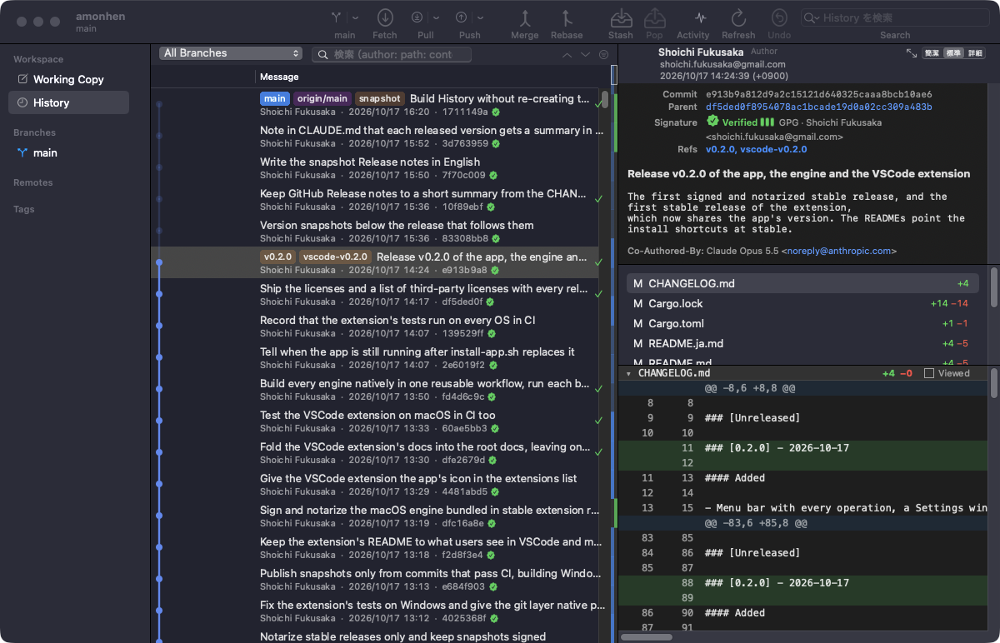

<h1></h1>

[日本語](README.ja.md)

A quick, responsive Git GUI. What I want, built by hand.

## Features

- **History** — Browse commits with a branch graph. Search them. Reword, squash, reorder, cherry-pick or revert them.
- **Line-by-line commits** — Pick exactly which lines go into a commit, and throw away the ones you don't want.
- **Undo** — Most operations can be undone, including rewriting history and dropping a stash.
- **Merge editor** — Resolve conflicts with both sides and the result in view.
- **Command line and VSCode** — The same features are available as the `amonhen` command and as a VSCode extension.
- **Over SSH** — Repositories on other machines work just like local ones.

> [!WARNING]
> This is a work in progress. Features, file formats and commands may change without notice, and it comes with no
> warranty. Keep backups of repositories that matter to you.

## Installation

On a Mac (macOS 14.4 or later, Apple silicon):

1. Download the latest [`Amon-Hen-<version>.zip`](https://github.com/fukusaka/amonhen/releases/latest).
2. Unzip it and move `Amon Hen.app` into `/Applications`.
3. Open it.

For Linux (an early GTK4 app, and the command line), Windows (command line), the VSCode extension, development builds and install scripts, see
[Installation](docs/install.md).

## Documents

- [Installation](docs/install.md)
- [Usage](docs/usage.md): the app, repositories over SSH, the command line
- [VSCode extension](apps/vscode)
- [Design](docs/design.md), and how [the VSCode extension](docs/vscode.md) and
  [the engine's protocol](docs/front.md) are built
- [Development](docs/development.md) and [making a release](docs/release.md)
- [Changelog](CHANGELOG.md)

## License

[MIT](LICENSE-MIT) or [Apache License 2.0](LICENSE-APACHE), at your option.
