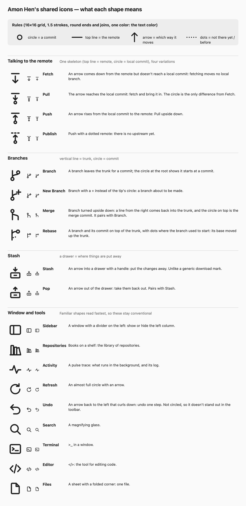

# Icons

[日本語](ja/icons.md)

Every front end draws the same icons: one set of shapes, kept as SVG in `crates/icons/svg`, drawn by each front end with its own renderer. This page records the rules, what each shape means, and how the set was decided.

## Why

Each front end used to take its icons from its own platform, so the same command looked different everywhere:

- The macOS app used SF Symbols.
- The GTK4 app drew about 75 icons with GSK paths, shaped after the macOS app's SF Symbols, since icon themes may lack branch and tag icons.
- The Windows app used WinUI's `Symbol` font, which has no Git shapes: Merge was Shuffle, Rebase was Sort, Stash was Save, Pop was OpenFile, Terminal was Keyboard. Tag signatures were emoji.
- The VSCode extension used codicons and a few characters (✎ ⌂ ⑂).
- The terminal front end uses text.

Pull, for one, was a circled arrow to a line on macOS, `repo-pull` in VSCode and Import on Windows. SF Symbols may only be used in apps for Apple platforms, so copying their shapes was no way to make the other front ends match.

Two directions were weighed: a shared, original set drawn by every front end, or each platform's own set with a shared table of meanings (and our own shapes only where a platform has none). The second keeps each platform's look but leaves the shapes different, which [frontends.md](frontends.md) would count as △ for anything the platform does not force. The shared set was chosen.

## Rules

- A 16×16 grid, strokes with round ends and round joins. Outline, not filled. The shapes are drawn with 1.5-unit strokes; each front end strokes them at its platform's weight (below).
- One color, chosen by the front end (normally the text color; the accent color for the current branch, and so on).
- A circle is a commit. A line across the top is the remote. An arrow is the direction something moves. Dots are something that is not there yet, or where something used to be.
- Shapes are drawn new, not traced from any platform's set. Tools everyone knows (search, refresh, terminal) keep their familiar shapes, since those read fastest.



## How the set was decided

1. The toolbar's 19 icons were drawn first and compared at 16, 20 and 48 points on light and dark backgrounds. At 16 the first Merge read as a person and Rebase's dotted line vanished, so both were redrawn, and Pull and Push got smaller arrowheads with more room.
2. Five shapes still didn't say what they mean: Merge (a common motif), Rebase (it only said that something moved), Stash and Pop (they looked like download and upload) and Repositories (it read as a cake or a tray). Each got three or four alternatives.
3. The chosen ones: Merge C (Branch upside down, so the two pair up), Rebase B (dots where the branch used to start), Stash and Pop B (a drawer), Repositories B (a bookshelf).
4. In the apps they looked out of place next to each platform's own icons. Measured on screenshots: the 1.5-unit strokes were heavier than SF Symbols on macOS (1.7pt against 1.4pt), Segoe Fluent Icons on Windows (1.9px against 1px) and codicons in VSCode (1.5 against 1), lighter than Adwaita in GTK4 (1.5px against 2px), and blurred at 100% because they fell between pixels. Two fixes were drawn as samples: each front end at its platform's weight, or one weight (1.25) everywhere. The first was chosen, with straight lines moved onto whole pixels.


## Implementation

`amonhen-icons` (`crates/icons`) reads `svg/*.svg` at build time and keeps each icon as strokes: SVG path data (circles and rectangles turned into paths) with an optional dash pattern, and the same path as a list of moves, lines, cubic Béziers and closes (arcs approximated by Béziers). It reads only the elements and attributes our own files use (`path`, `circle`, `rect`; `d`, `cx`, `cy`, `r`, `x`, `y`, `width`, `height`, `rx`, `stroke-dasharray`) and stops the build on anything else.

Front ends draw `Icon::strokes(size, pixel_scale, stroke)`: the shape at the drawing size and the front end's weight, with vertical and horizontal lines moved onto whole pixels (centred on a pixel for odd widths, on a pixel edge for even ones). A coordinate used by a straight line moves the same way everywhere, and parts without straight lines (arrowheads, circles) move whole with the point they join or, failing that, their centre, so the shapes keep their symmetry. Lines are stroked with round caps and joins; a dash of length 0 with round caps makes a dot.

- GTK4: 2px at 16px (Adwaita's symbolic icons), in the text colour itself (the older icons are drawn at 70%). `apps/gtk4/src/icon.rs` builds a GSK path per name, size and scale factor.
- macOS: 1.4pt at 18pt (SF Symbols' regular weight in the toolbar), in proportion at other sizes, snapped for the screen it is drawn on. The C ABI hands over the strokes (`amonhen_icon_strokes`); `SharedIcons` in AmonhenKit turns them into `CGPath`s and `AppIcons` in the app strokes them into template images, so the toolbar and sidebar tint them like SF Symbols. `NSImage` reads SVG on current macOS, but whether it does on 14.4, the oldest supported version, has not been checked, so the app doesn't depend on it. The toolbar's sidebar toggle and search field are AppKit's own items and keep their system look, and Finder keeps Finder's folder.
- Windows: 1px at 20px (Segoe Fluent Icons), snapped for the window's scale. WinUI's icon elements (`PathIcon`, `FontIcon`) only fill, so the toolbar and its customization palette stroke each shape with XAML's `Path` shape (dashes in units of the thickness, the text colour from the theme). windows-reactor had no `Path`; it was added to the vendored copy, with the `Shape` and `Path` bindings generated by windows-bindgen from the Windows App SDK's winmd. Files keeps Explorer's folder from Segoe Fluent Icons.
- VSCode: 1px at 16px (codicons), on the sidebar's title buttons (Fetch, Pull, Push / Publish, Undo, Select Repository, Refresh, Switch Branch, New Branch, Stash) and branch rows. VSCode draws an extension's SVG icons as images, which can't take the theme's colors (`currentColor` comes out black, and `prefers-color-scheme` inside an SVG image reflects the OS appearance by default, not the VSCode theme; not tested), so `media/icons/` has a light and a dark copy of each shape with VSCode's default icon colors (`icon.foreground`, and `charts.green` for a branch checked out in another worktree), snapped for 100% (which also lands on whole pixels at 200%). They are made with `cargo run -p amonhen-icons --example vscode`, and a test fails when they no longer match the shapes. Unlike codicons, they don't follow a theme's own icon color, high contrast or the selected row's color; an icon font (`contributes.icons`) would, and was left aside.

The figures on this page come from `crates/icons/tools/figures.swift` (on macOS) with the data next to it; the drafts are kept in `crates/icons/tools/alternatives`:

```bash
cd crates/icons/tools
swift figures.swift intent intent.en.tsv ../svg ../../../docs/images/icons/intent.en.png
swift figures.swift alternatives alternatives.en.tsv alternatives ../../../docs/images/icons/alternatives.en.png
```

## Status

- [x] The rules and the toolbar's 19 icons
- [x] GTK4: the toolbar (and the same kinds elsewhere, such as Branch in the sidebar)
- [x] macOS: the toolbar and the sidebar's branches
- [x] Windows: the toolbar
- [x] The other 72 shapes (sidebar sections, branch and worktree states, tools, settings pages, signatures, clone states, CI, AI, image comparison), chosen from three or four drafts each where the first one didn't read well
- [x] The other 72 shapes in the front ends:
  - GTK4: every icon is from the shared set; the hand-drawn paths are gone.
  - macOS: SF Symbols with a shared shape are mapped by name (`AppIcons.bySymbol`), including History's signature marks; system controls (chevrons, plus, close, info) and CI's small dots in History stay as SF Symbols.
  - VSCode: tree rows (sections, worktrees, branches, tags and their signatures, stashes, remotes, submodules, subtrees) and the branch and ignored-file pickers; codicons stay in tooltips and for rows without a shared shape (a paused sequence, the inactive and archived branch groups, a signature being checked).
  - Windows: the file list's buttons, diff options, edit mode, All Files and the image diff (drawn with Direct2D). The sidebar puts the shared icon in front of every row (the current branch and the open worktree in the accent color) and uses the shared shapes for the marks at a row's end.
- [x] VSCode: the sidebar's title buttons and branch rows
- [x] A pull request's shape (the sidebar's pull request rows in macOS, GTK4 and Windows), chosen from four drafts: D, B's arrow under the line for a remote, as the request is made on GitHub
- [x] The Windows app's icon: the macOS app icon's picture in Windows' frame (`scripts/make-icon.swift --windows`: it fills the canvas, without a shadow and with smaller corners, and leaves out the faint stars at 32 px and below), in the executable and set on each window
- Not decided: whether the app icon is redrawn (GTK4 and the VSCode Marketplace use the macOS-framed picture as it is, and VSCode's activity bar has its own mark), the VSCode format, and whether the terminal front end gets anything (it shows text).
