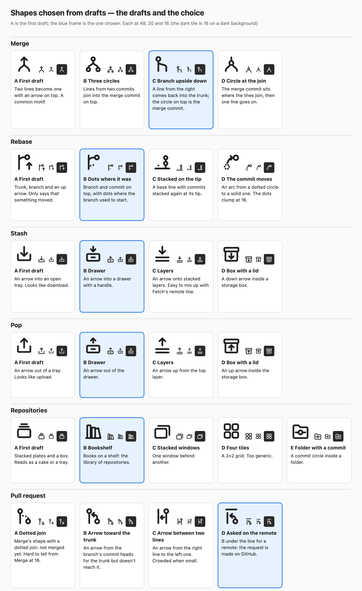

# Icons

[日本語](ja/icons.md)

Every front end draws the same icons: one set of shapes, kept as SVG in `crates/icons/svg`, drawn by each front end with its own renderer. This page records the rules, what each shape means, and how the set was decided.

## Why

Each front end used to take its icons from its own platform, so the same command looked different everywhere:

- The macOS app used SF Symbols.
- The GTK4 app drew about 75 icons with GSK paths, shaped after the macOS app's SF Symbols, since icon themes may lack branch and tag icons.
- The Windows app used WinUI's `Symbol` font, which has no Git shapes: Merge was Shuffle, Rebase was Sort, Stash was Save, Pop was OpenFile, Terminal was Keyboard. Tag signatures were emoji.
- The VSCode extension used codicons and a few characters (✎ ⌂ ⑂).
- The terminal front end uses text.

Pull, for one, was a circled arrow to a line on macOS, `repo-pull` in VSCode and Import on Windows. SF Symbols may only be used in apps for Apple platforms, so copying their shapes was no way to make the other front ends match.

Two directions were weighed: a shared, original set drawn by every front end, or each platform's own set with a shared table of meanings (and our own shapes only where a platform has none). The second keeps each platform's look but leaves the shapes different, which [frontends.md](frontends.md) would count as △ for anything the platform does not force. The shared set was chosen.

## Rules

- A 16×16 grid, 1.5-unit strokes, round ends and round joins. Outline, not filled.
- One color, chosen by the front end (normally the text color; the accent color for the current branch, and so on).
- A circle is a commit. A line across the top is the remote. An arrow is the direction something moves. Dots are something that is not there yet, or where something used to be.
- Shapes are drawn new, not traced from any platform's set. Tools everyone knows (search, refresh, terminal) keep their familiar shapes, since those read fastest.


## How the set was decided

1. The toolbar's 19 icons were drawn first and compared at 16, 20 and 48 points on light and dark backgrounds. At 16 the first Merge read as a person and Rebase's dotted line vanished, so both were redrawn, and Pull and Push got smaller arrowheads with more room.
2. Five shapes still didn't say what they mean: Merge (a common motif), Rebase (it only said that something moved), Stash and Pop (they looked like download and upload) and Repositories (it read as a cake or a tray). Each got three or four alternatives.
3. The chosen ones: Merge C (Branch upside down, so the two pair up), Rebase B (dots where the branch used to start), Stash and Pop B (a drawer), Repositories B (a bookshelf).



## Implementation

`amonhen-icons` (`crates/icons`) reads `svg/*.svg` at build time and keeps each icon as strokes: SVG path data (circles and rectangles turned into paths) with an optional dash pattern, and the same path as a list of moves, lines, cubic Béziers and closes (arcs approximated by Béziers) for renderers without SVG arcs. It reads only the elements and attributes our own files use (`path`, `circle`, `rect`; `d`, `cx`, `cy`, `r`, `x`, `y`, `width`, `height`, `rx`, `stroke-dasharray`) and stops the build on anything else. Front ends stroke the paths with `STROKE_WIDTH` and round caps and joins; a dash of length 0 with round caps makes a dot.

- GTK4: `gsk::Path::parse` reads the path data; `apps/gtk4/src/icon.rs` strokes it (parsed once per shape) for the kinds the shared set covers. A test checks that GSK parses every shape.
- macOS: the C ABI hands over the move/line/Bézier lists (`amonhen_icon_shape`); `SharedIcons` in AmonhenKit turns them into `CGPath`s and `AppIcons` in the app strokes them into template images, so the toolbar and sidebar tint them like SF Symbols. `NSImage` reads SVG on current macOS, but whether it does on 14.4, the oldest supported version, has not been checked, so the app doesn't depend on it. The toolbar's sidebar toggle and search field are AppKit's own items and keep their system look, and Finder keeps Finder's folder.
- Windows (planned): WinUI's `PathIcon` takes path data; windows-reactor's toolbar buttons take only a `Symbol` today and need widening.
- VSCode (planned): `package.json` icons can be SVG files for light and dark themes, or a font registered with `contributes.icons` (which follows the theme's colors but needs a tool to build the font). Not decided.

The figures on this page come from `crates/icons/tools/figures.swift` (on macOS) with the data next to it; the drafts are kept in `crates/icons/tools/alternatives`:

```bash
cd crates/icons/tools
swift figures.swift intent intent.en.tsv ../svg ../../../docs/images/icons/intent.en.png
swift figures.swift alternatives alternatives.en.tsv alternatives ../../../docs/images/icons/alternatives.en.png
```

## Status

- [x] The rules and the toolbar's 19 icons
- [x] GTK4: the toolbar (and the same kinds elsewhere, such as Branch in the sidebar)
- [x] macOS: the toolbar and the sidebar's branches
- [ ] The other icons (about 55: sidebar sections, states, signature marks, …)
- [ ] Windows, VSCode
- Not decided: whether the app icon is redrawn too, the VSCode format, and whether the terminal front end gets anything (it shows text).
