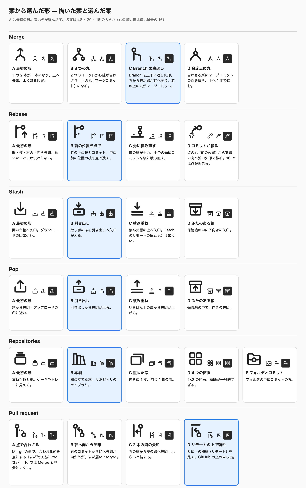

# アイコン

[English](../icons.md)

どの FE も同じアイコンを描く。形は 1 組で、`crates/icons/svg` に SVG として置き、各 FE が自分の描画で描く。このページには、決まりと各形の意味、どう決めたかを残す。

## なぜ

もとは各 FE がそれぞれの土台のアイコンを使っていて、同じ操作が FE ごとに違う形だった。

- macOS のアプリは SF Symbols。
- GTK4 のアプリは、約 75 種を GSK のパスで描いていた。アイコンのテーマにブランチやタグがないことがあるためで、形は macOS のアプリの SF Symbols に寄せていた。
- Windows のアプリは WinUI の `Symbol` のフォント。Git の形がなく、Merge は Shuffle、Rebase は Sort、Stash は Save、Pop は OpenFile、Terminal は Keyboard だった。タグの署名は絵文字。
- VSCode 拡張は codicon と記号（✎ ⌂ ⑂）。
- 端末の FE は文字。

たとえば Pull は、macOS では丸で囲んだ線への矢印、VSCode では `repo-pull`、Windows では Import だった。SF Symbols は Apple のプラットフォームのアプリでしか使えないので、その形を写してほかの FE をそろえることはできない。

2 つの方向を比べた。どの FE も描く共通の独自セットにするか、各土台のセットに意味の対応表を添える（土台にない形だけ自前で描く）か。後者は各土台の見た目になじむが形の差が残り、[frontends.md](frontends.md) の決まりでは、土台が強いない差は △ になる。共通のセットにした。

## 決まり

- 16×16 の格子、端も角も丸い線。塗りではなく線。形は太さ 1.5 で描き、各 FE はそれぞれの土台の太さで引く（下の「作り」）。
- 色は 1 色で、FE が決める（ふつうは文字の色。チェックアウト中のブランチは強調の色、など）。
- 丸はコミット。上の横線はリモート。矢印は動く向き。点線はまだないもの、または前の位置。
- 形は新しく描き、どの土台のセットも写さない。誰でも知っている道具（検索・更新・端末）は、そのほうが早く読めるので見慣れた形のままにする。


## どう決めたか

1. 最初にツールバーの 19 種を描き、16・20・48 の大きさで明るい背景と暗い背景に並べた。16 では最初の Merge が人の形に見え、Rebase の点線が消えたので描き直した。Pull と Push は矢印を小さくし、間を空けた。
2. それでも意味が伝わらない 5 つ（Merge はよくある図案、Rebase は動いたことしか言えない、Stash と Pop はダウンロードとアップロードに見える、Repositories はケーキやトレーに見える）に、3〜4 個ずつ別の案を描いた。
3. 選んだ案: Merge は C（Branch の裏返しで、Branch と対になる）、Rebase は B（前の根元を点で残す）、Stash と Pop は B（引き出し）、Repositories は B（本棚）。
4. アプリに入れると、各土台の標準のアイコンの中で浮いて見えた。撮った画面で測ると、太さ 1.5 の線は macOS の SF Symbols（1.7pt と 1.4pt）、Windows の Segoe Fluent Icons（1.9px と 1px）、VSCode の codicon（1.5 と 1）より太く、GTK4 の Adwaita（1.5px と 2px）より細かった。100% の画面では画素の間にかかってにじんでいた。直し方を 2 つ見本にした。FE ごとに土台の太さにするか、全 FE で 1 つの太さ（1.25）にするか。前者を選び、縦・横の線を画素に乗せた。
5. 残りの 72 種（サイドバーの節、ブランチと worktree の状態、道具、設定の画面、署名、取得のしかた、CI、AI、画像の比べ）も同じように描いた。最初の形で読みにくい 31 種には 3 つ以上の別案を描き、それでも決まらないものはさらに足した（メインの worktree は 16 案）。Pull request の形は、あとで 4 案から選んだ。



残りの形の意味と、選んだもとの案:


## 作り

`amonhen-icons`（`crates/icons`）が、ビルドのときに `svg/*.svg` を読み、各アイコンを線として持つ。線は SVG のパス（円と四角はパスに直す）と、あれば破線の長さ、それに同じ線を移動・直線・3 次ベジェ・閉じるの列（弧はベジェで近づける）にしたもの。自分で描いたファイルが使う要素と属性（`path`・`circle`・`rect`、`d`・`cx`・`cy`・`r`・`x`・`y`・`width`・`height`・`rx`・`stroke-dasharray`）だけを読み、ほかがあればビルドを止める。

FE は `Icon::strokes(size, pixel_scale, stroke)` を描く。描く大きさ・FE の太さの形で、縦・横の線を画素に乗せてある（太さが奇数の画素なら画素の中心、偶数なら画素の境目）。縦・横の線が使う座標はどこでも同じだけ動かし、縦・横の線を持たない部分（矢じり・丸）は、つながる点と同じだけ（なければ真ん中を合わせて）丸ごと動かすので、形の左右はそろったまま。線は丸い端と角で引く。長さ 0 の破線と丸い端で点になる。

- GTK4: 16px で 2px（Adwaita の記号のアイコン）、色は文字の色そのまま（前からのアイコンは 70% の濃さ）。`apps/gtk4/src/icon.rs` が名前・大きさ・画面の倍率ごとに GSK のパスを作る。
- macOS: 18pt で 1.4pt（ツールバーの SF Symbols の regular）、ほかの大きさでは同じ割合で、描く画面に合わせて画素に乗せる。C ABI（`amonhen_icon_strokes`）で線を渡し、AmonhenKit の `SharedIcons` が `CGPath` にし、アプリの `AppIcons` が線を引いてテンプレート画像にする。ツールバーとサイドバーが SF Symbols と同じように色を付ける。今の macOS の `NSImage` は SVG を読めるが、対応する最も古い 14.4 で読めるかは確かめていないので、それには頼らない。ツールバーのサイドバーの切り替えと検索欄は AppKit の部品なのでシステムの見た目のまま、Finder は Finder のフォルダのまま。
- Windows: 20px で 1px（Segoe Fluent Icons）、窓の倍率に合わせて画素に乗せる。WinUI のアイコンの部品（`PathIcon`・`FontIcon`）は塗るだけなので、ツールバーとそのカスタマイズのパレットでは、形ごとに XAML の図形の `Path` で線を引く（破線は太さを 1 とした長さ、色はテーマの文字の色）。windows-reactor に `Path` がなかったので、vendor の写しに足した（`Shape` と `Path` のバインディングは、Windows App SDK の winmd から windows-bindgen で作った）。Files は Segoe Fluent Icons の Explorer のフォルダのまま。
- VSCode: 16px で 1px（codicon）。サイドバーの見出しのボタン（Fetch・Pull・Push / Publish・Undo・Select Repository・Refresh・Switch Branch・New Branch・Stash）とブランチの行。VSCode は拡張の SVG を画像として描き、テーマの色を受け継げない（`currentColor` は黒になる）ので、形はアイコンのフォント `media/amonhen-icons.ttf` の字にし、`package.json` の `contributes.icons` に `amonhen-<名前>` で登録して codicon と同じように描かせる。テーマのアイコンの色・ハイコントラスト・選んだ行の色に従い、状態の色はテーマの色（ほかの worktree が checkout しているブランチは `charts.green`）。字は、100% の画面に合わせて画素に乗せた太さ 1px の線を輪郭に直したもので、1em は 16px（200% でもそのまま画素に乗る）。フォントと `contributes.icons` は `cargo run -p amonhen-icons --example vscode`（`crates/icons/tools/vscode_font.rs`）で作り、形と合わなくなればテストが落ちる。字の番号は名前ごとに `crates/icons/tools/vscode-codepoints.tsv` で決めておく。足した形には最後の番号の次を振り、使わなくなった名前の行も残すので、形を足してもほかの字の番号は動かない。形ごとにライトとダークの SVG を置くやり方と、VSCode の明るい・暗い・ハイコントラストのテーマで比べて選んだ（形と鮮明さは同じで、テーマに従うのはフォントだけだった）。メインビューのタブはアクティビティバーの印を SVG のまま使う（Webview のパネルには画像しか渡せない）。

このページの図は `crates/icons/tools/figures.swift`（macOS で）と、その横のデータから作る。描いた案は `crates/icons/tools/alternatives` に残す。

```bash
cd crates/icons/tools
swift figures.swift intent intent.ja.tsv ../svg ../../../docs/images/icons/intent.ja.png
swift figures.swift alternatives alternatives.ja.tsv alternatives ../../../docs/images/icons/alternatives.ja.png
swift figures.swift intent intent-rest.ja.tsv ../svg ../../../docs/images/icons/intent-rest.ja.png
swift figures.swift alternatives alternatives-rest.ja.tsv alternatives ../../../docs/images/icons/alternatives-rest.ja.png
```

## 端末の FE

端末の FE は線を引けないので、共通の名前ごとに 1 文字を出す。下の表は決めたが、まだコードには入れていない（端末の FE は今も自分の文字を使っている）。

- Unicode の東アジアの幅が N か Na の文字だけにし、どの言語の設定でも 1 マスに収める。● ↑ ★ ▸ のような曖昧幅の文字は、日本語の設定の GNOME 端末では 2 マスで描かれるが、`unicode-width` は 1 マスと数える。
- 絵文字の性質を持つ文字は使わない。Windows Terminal はフォントにない字を色つきの絵文字で描くことがある（✔ と ⏲ がそうだった）。
- 3 つの端末の既定のフォントで確かめた。GNOME 端末（Ubuntu Sans Mono、日本語の設定）、macOS の Terminal（SF Mono）、Windows Terminal（Cascadia Mono）。ほとんどの文字はこれらのフォントになく、ほかのフォントで補われる。macOS の Terminal は字形をマスに縮め、GNOME 端末は隣のマスへはみ出させ、Windows Terminal は Segoe UI Symbol から取る。どれかではみ出した文字は替えたので、丸い形（円の矢印・歯車・丸で囲んだ星）はほとんど使えない。
- できるところは共通の形に合わせる。リモートは上の横線（`⊤`、リモートに同じ名前の別のタグがあるときは `⍡`）、詳細を広げるは斜めの両向きの矢印（`⤢`）、広げた詳細を戻すはもう一方の斜め（`⤡`。内向きの矢印の字はない）、枠に合わせるは枠（`⬚`）、確かめられないは丸に「!」と同じ `!`。
- 同じ意味の名前は同じ文字にする（失敗と CI 失敗は `✗`、取り消しと CI 取り消しは `⊘`、2 つの新しいブランチは `⁺`、書き込む先の worktree と Working Copy は同じ形なので `✎`）。署名が不正も `✗` を使う（署名の中にしか出ない）。意味が違えば文字も分ける。変更なし `=`・署名あり `ʃ`・CI 成功 `✓`、確かめられない `!`（丸に「!」）と種類の分からないもの `?`（紙に「?」）。
- CI 実行中の `⣾` は点字の回る印の 1 こまなので、⣾⣽⣻⢿⡿⣟⣯⣷ を順に出せる。更新の `⤸` は macOS の Terminal では小さく描かれる。読みやすい円の矢印は GNOME 端末ではみ出す。

| 名前 | 意味 | 文字 | 符号位置 |
| --- | --- | --- | --- |
| `account` | Accounts | `@` | U+0040 |
| `activity` | Activity | `≋` | U+224B |
| `ahead-behind` | 先／遅れ | `↨` | U+21A8 |
| `ai` | AI の解説・提案 | `✦` | U+2726 |
| `appearance` | Appearance | `☾` | U+263E |
| `back` | 戻る | `‹` | U+2039 |
| `bad-signature` | 不正な署名 | `✗` | U+2717 |
| `branch` | Branch | `⑂` | U+2442 |
| `cancelled` | 取り消した | `⊘` | U+2298 |
| `cannot-verify` | この git では確かめられない | `!` | U+0021 |
| `changed-pixels` | 違うピクセル | `⊹` | U+22B9 |
| `checkerboard` | 市松模様 | `▚` | U+259A |
| `ci-cancelled` | CI を取り消した | `⊘` | U+2298 |
| `ci-failed` | CI が失敗した | `✗` | U+2717 |
| `ci-none` | CI がない | `◌` | U+25CC |
| `ci-passed` | CI が通った | `✓` | U+2713 |
| `ci-running` | CI が走っている | `⣾` | U+28FE |
| `clean` | 変更なし | `=` | U+003D |
| `collapse-all` | すべて畳む | `⊟` | U+229F |
| `conflict` | コンフリクト | `‼` | U+203C |
| `current-branch` | 今のブランチ | `▹` | U+25B9 |
| `disconnected` | 切れたつながり | `⌁` | U+2301 |
| `display-options` | 表示のメニュー | `⁑` | U+2051 |
| `edit-mode` | 編集モード | `✐` | U+2710 |
| `edited-worktree` | 書き込む先 | `✎` | U+270E |
| `editor` | Editor | `⟨` | U+27E8 |
| `expand` | 詳細を広げる | `⤢` | U+2922 |
| `expand-all` | すべて開く | `⊞` | U+229E |
| `expired-key` | 期限の切れた鍵 | `⧖` | U+29D6 |
| `failed` | 失敗 | `✗` | U+2717 |
| `favorite` | お気に入り | `✭` | U+272D |
| `fetch` | Fetch | `⇣` | U+21E3 |
| `files` | Files | `▯` | U+25AF |
| `filter` | 絞り込み | `⋎` | U+22CE |
| `folder` | フォルダ | `▭` | U+25AD |
| `go-to-head` | Go to HEAD | `⇥` | U+21E5 |
| `history` | History | `↺` | U+21BA |
| `list` | 一覧 | `≣` | U+2263 |
| `main-worktree` | メインの worktree | `⌂` | U+2302 |
| `merge` | Merge | `⑃` | U+2443 |
| `missing-key` | 鍵がない | `⚷` | U+26B7 |
| `modified` | 変更あり | `⁎` | U+204E |
| `new-branch` | New Branch | `⁺` | U+207A |
| `new-branch-row` | 新しいブランチの行 | `⁺` | U+207A |
| `not-checked-out` | 取り出していない | `∘` | U+2218 |
| `onion-skin` | オニオンスキン | `⊓` | U+2293 |
| `partial` | partial clone | `⊏` | U+228F |
| `performance` | Performance | `ϟ` | U+03DF |
| `pop` | Pop | `⤉` | U+2909 |
| `preview` | プレビュー | `⌾` | U+233E |
| `publish` | Publish | `⇡` | U+21E1 |
| `pull` | Pull | `⤓` | U+2913 |
| `pull-request` | Pull request | `⥂` | U+2942 |
| `push` | Push | `⤒` | U+2912 |
| `range-diff` | Range Diff | `≍` | U+224D |
| `rebase` | Rebase | `↱` | U+21B1 |
| `reflog` | Reflog | `↜` | U+219C |
| `refresh` | Refresh | `⤸` | U+2938 |
| `remote` | Remotes | `⊤` | U+22A4 |
| `remote-conflict` | リモートのタグの衝突 | `⍡` | U+2361 |
| `repositories` | Repositories | `⦙` | U+2999 |
| `restore` | 広げた詳細を戻す | `⤡` | U+2921 |
| `revoked-key` | 失効した鍵 | `⌀` | U+2300 |
| `search` | Search | `⌕` | U+2315 |
| `settings` | 設定 | `⋮` | U+22EE |
| `shallow` | shallow clone | `⋯` | U+22EF |
| `side-by-side` | 並べる | `⫴` | U+2AF4 |
| `sidebar` | Sidebar | `⎸` | U+23B8 |
| `signed` | 確かめた | `ʃ` | U+0283 |
| `signer-mismatch` | 署名した人が違う | `≁` | U+2241 |
| `sparse` | sparse checkout | `⁘` | U+2058 |
| `stacked` | 積んだブランチ | `⫶` | U+2AF6 |
| `stash` | Stash | `⤈` | U+2908 |
| `stashes` | Stashes | `⊔` | U+2294 |
| `submodule` | Submodules | `⊡` | U+22A1 |
| `subtree` | Subtrees | `⤷` | U+2937 |
| `swipe` | スワイプ | `⇹` | U+21F9 |
| `tag` | Tags | `⬦` | U+2B26 |
| `terminal` | Terminal | `≻` | U+227B |
| `theme` | Theme | `◬` | U+25EC |
| `translate` | AI の翻訳 | `⥊` | U+294A |
| `tree` | 木 | `⊢` | U+22A2 |
| `trust-unknown` | 信用度が未定 | `⸮` | U+2E2E |
| `undo` | Undo | `↩` | U+21A9 |
| `unknown-file` | 種類の分からないもの | `?` | U+003F |
| `upstream-gone` | 上流が消えた | `⍊` | U+234A |
| `whitespace` | 空白 | `␣` | U+2423 |
| `working-copy` | Working Copy | `✎` | U+270E |
| `wrap-lines` | 折り返し | `↵` | U+21B5 |
| `zoom-fit` | 枠に合わせる | `⬚` | U+2B1A |
| `zoom-in` | 拡大 | `+` | U+002B |
| `zoom-out` | 縮小 | `-` | U+002D |

## 進み具合

- [x] 決まりと、ツールバーの 19 種
- [x] GTK4: ツールバー（と、サイドバーの Branch など、ほかの所の同じ種類）
- [x] macOS: ツールバーと、サイドバーのブランチ
- [x] Windows: ツールバー
- [x] 残りの 72 種の形（サイドバーの節、ブランチと worktree の状態、道具、設定の画面、署名、取得のしかた、CI、AI、画像の比べ）。最初の形で読みにくいものは、3〜4 案から選んだ
- [x] 残りの 72 種を各 FE で使う:
  - GTK4: すべてのアイコンを共通のセットから描く。手描きのパスはなくした。
  - macOS: 共通の形がある SF Symbols を名前で対応させる（`AppIcons.bySymbol`）。History の署名の印も含む。標準の部品の記号（山形・＋・×・情報）、History の CI の小さな点は SF Symbols のまま。
  - VSCode: 木の行（節・worktree・ブランチ・タグとその署名・Stash・リモート・submodule・subtree）と、ブランチ・無視されたファイルの選択。吹き出しの中と、共通の形のない行（止まっている sequence、使っていない・アーカイブしたブランチの組、確かめている途中の署名）は codicon のまま。
  - Windows: 変更されたファイルの欄のボタン、差分の表示の設定、編集モード、すべてのファイル、画像の差分（Direct2D で描く）。サイドバーは、どの行も前に共通のアイコンを出し（今のブランチと開いている worktree は強調の色）、行の右端の印も共通の形にする。
- [x] VSCode: サイドバーの見出しのボタンとブランチの行
- [x] Pull request の形（macOS・GTK4・Windows のサイドバーの Pull request の行）。4 案から D（B の矢印に、リモートの上の横線を足す。GitHub の上の申し出）を選んだ
- [x] Windows のアプリのアイコン: macOS のアプリのアイコンの絵を Windows の枠で（`scripts/make-icon.swift --windows`。枠いっぱいに、影なし、角の丸みは小さく、32 px までは淡い星を描かない）。exe に入れ、窓ごとにも付ける
- [x] VSCode のアクティビティバーの印（1 色で、VSCode が色を付ける）: 二重の山はそのままに、太さ 1.5 の線で描き直し、頂上を座の輪にして外の山は輪の手前で止める。アプリのアイコンの稜線・レーン・座・星を線にした案から選んだ（2 本の線の間の輪は人の形に読め、4 方向の光の星は AI の印）
- [x] GTK4 のアプリのアイコン: 同じ絵を GNOME の形で（`scripts/make-icon.swift --gnome`。128 の格子で幅 104・角の丸み 8 の角丸の四角、下に厚みの 4 px の暗い縁、影なし、32 px までは淡い星を描かない）。16〜512 の大きさごとに `hicolor` に置く。円（丘と星が切れる）と縁なしの四角から選んだ
- [x] VSCode 拡張のアイコン（`package.json` の `icon`。VSCode の拡張機能ビューに出る。拡張は Marketplace には出していない）: Windows のアイコンの絵を 256 px で（`scripts/make-icon.swift --vscode`）。VSCode は切り抜かずにそのまま描くので
- [x] 端末の FE の文字: 共通の名前ごとに 1 文字、GNOME 端末・macOS の Terminal・Windows Terminal で確かめた（上の表）。端末の FE ではまだ使っていない
- [x] VSCode の形式: テーマに従うよう、SVG の写しではなくアイコンのフォント（`contributes.icons`）
