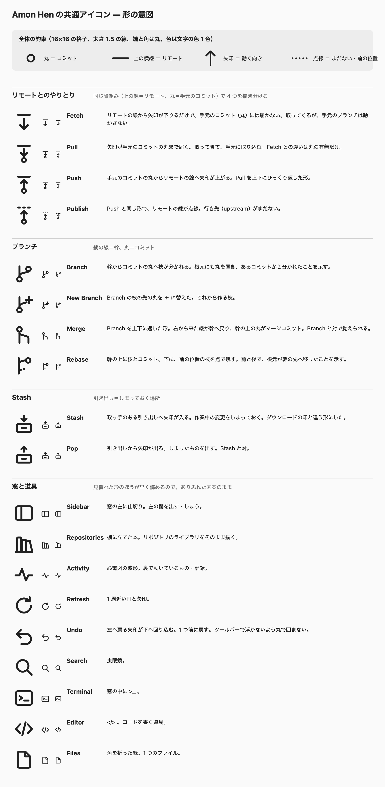

# アイコン

[English](../icons.md)

どの FE も同じアイコンを描く。形は 1 組で、`crates/icons/svg` に SVG として置き、各 FE が自分の描画で描く。このページには、決まりと各形の意味、どう決めたかを残す。

## なぜ

もとは各 FE がそれぞれの土台のアイコンを使っていて、同じ操作が FE ごとに違う形だった。

- macOS のアプリは SF Symbols。
- GTK4 のアプリは、約 75 種を GSK のパスで描いていた。アイコンのテーマにブランチやタグがないことがあるためで、形は macOS のアプリの SF Symbols に寄せていた。
- Windows のアプリは WinUI の `Symbol` のフォント。Git の形がなく、Merge は Shuffle、Rebase は Sort、Stash は Save、Pop は OpenFile、Terminal は Keyboard だった。タグの署名は絵文字。
- VSCode 拡張は codicon と記号（✎ ⌂ ⑂）。
- 端末の FE は文字。

たとえば Pull は、macOS では丸で囲んだ線への矢印、VSCode では `repo-pull`、Windows では Import だった。SF Symbols は Apple のプラットフォームのアプリでしか使えないので、その形を写してほかの FE をそろえることはできない。

2 つの方向を比べた。どの FE も描く共通の独自セットにするか、各土台のセットに意味の対応表を添える（土台にない形だけ自前で描く）か。後者は各土台の見た目になじむが形の差が残り、[frontends.md](frontends.md) の決まりでは、土台が強いない差は △ になる。共通のセットにした。

## 決まり

- 16×16 の格子、端も角も丸い線。塗りではなく線。形は太さ 1.5 で描き、各 FE はそれぞれの土台の太さで引く（下の「作り」）。
- 色は 1 色で、FE が決める（ふつうは文字の色。チェックアウト中のブランチは強調の色、など）。
- 丸はコミット。上の横線はリモート。矢印は動く向き。点線はまだないもの、または前の位置。
- 形は新しく描き、どの土台のセットも写さない。誰でも知っている道具（検索・更新・端末）は、そのほうが早く読めるので見慣れた形のままにする。



## どう決めたか

1. 最初にツールバーの 19 種を描き、16・20・48 の大きさで明るい背景と暗い背景に並べた。16 では最初の Merge が人の形に見え、Rebase の点線が消えたので描き直した。Pull と Push は矢印を小さくし、間を空けた。
2. それでも意味が伝わらない 5 つ（Merge はよくある図案、Rebase は動いたことしか言えない、Stash と Pop はダウンロードとアップロードに見える、Repositories はケーキやトレーに見える）に、3〜4 個ずつ別の案を描いた。
3. 選んだ案: Merge は C（Branch の裏返しで、Branch と対になる）、Rebase は B（前の根元を点で残す）、Stash と Pop は B（引き出し）、Repositories は B（本棚）。
4. アプリに入れると、各土台の標準のアイコンの中で浮いて見えた。撮った画面で測ると、太さ 1.5 の線は macOS の SF Symbols（1.7pt と 1.4pt）、Windows の Segoe Fluent Icons（1.9px と 1px）、VSCode の codicon（1.5 と 1）より太く、GTK4 の Adwaita（1.5px と 2px）より細かった。100% の画面では画素の間にかかってにじんでいた。直し方を 2 つ見本にした。FE ごとに土台の太さにするか、全 FE で 1 つの太さ（1.25）にするか。前者を選び、縦・横の線を画素に乗せた。


## 作り

`amonhen-icons`（`crates/icons`）が、ビルドのときに `svg/*.svg` を読み、各アイコンを線として持つ。線は SVG のパス（円と四角はパスに直す）と、あれば破線の長さ、それに同じ線を移動・直線・3 次ベジェ・閉じるの列（弧はベジェで近づける）にしたもの。自分で描いたファイルが使う要素と属性（`path`・`circle`・`rect`、`d`・`cx`・`cy`・`r`・`x`・`y`・`width`・`height`・`rx`・`stroke-dasharray`）だけを読み、ほかがあればビルドを止める。

FE は `Icon::strokes(size, pixel_scale, stroke)` を描く。描く大きさ・FE の太さの形で、縦・横の線を画素に乗せてある（太さが奇数の画素なら画素の中心、偶数なら画素の境目）。縦・横の線が使う座標はどこでも同じだけ動かし、縦・横の線を持たない部分（矢じり・丸）は、つながる点と同じだけ（なければ真ん中を合わせて）丸ごと動かすので、形の左右はそろったまま。線は丸い端と角で引く。長さ 0 の破線と丸い端で点になる。

- GTK4: 16px で 2px（Adwaita の記号のアイコン）、色は文字の色そのまま（前からのアイコンは 70% の濃さ）。`apps/gtk4/src/icon.rs` が名前・大きさ・画面の倍率ごとに GSK のパスを作る。
- macOS: 18pt で 1.4pt（ツールバーの SF Symbols の regular）、ほかの大きさでは同じ割合で、描く画面に合わせて画素に乗せる。C ABI（`amonhen_icon_strokes`）で線を渡し、AmonhenKit の `SharedIcons` が `CGPath` にし、アプリの `AppIcons` が線を引いてテンプレート画像にする。ツールバーとサイドバーが SF Symbols と同じように色を付ける。今の macOS の `NSImage` は SVG を読めるが、対応する最も古い 14.4 で読めるかは確かめていないので、それには頼らない。ツールバーのサイドバーの切り替えと検索欄は AppKit の部品なのでシステムの見た目のまま、Finder は Finder のフォルダのまま。
- Windows: 20px で 1px（Segoe Fluent Icons）、窓の倍率に合わせて画素に乗せる。WinUI のアイコンの部品（`PathIcon`・`FontIcon`）は塗るだけなので、ツールバーとそのカスタマイズのパレットでは、形ごとに XAML の図形の `Path` で線を引く（破線は太さを 1 とした長さ、色はテーマの文字の色）。windows-reactor に `Path` がなかったので、vendor の写しに足した（`Shape` と `Path` のバインディングは、Windows App SDK の winmd から windows-bindgen で作った）。Files は Segoe Fluent Icons の Explorer のフォルダのまま。
- VSCode: 16px で 1px（codicon）。サイドバーの見出しのボタン（Fetch・Pull・Push / Publish・Undo・Select Repository・Refresh・Switch Branch・New Branch・Stash）とブランチの行。VSCode は拡張の SVG を画像として描き、テーマの色を受け継げない（`currentColor` は黒になり、SVG の画像の中の `prefers-color-scheme` は、既定では VSCode のテーマではなく OS の外観に従う。ここは試していない）ので、`media/icons/` に形ごとにライトとダークの写しを置く。色は VSCode の既定のアイコンの色（`icon.foreground`、ほかの worktree が checkout しているブランチは `charts.green`）で、100% の画面に合わせて画素に乗せる（200% でもそのまま画素に乗る）。`cargo run -p amonhen-icons --example vscode` で作り、形と合わなくなればテストが落ちる。codicon と違い、テーマ独自のアイコンの色・ハイコントラスト・選んだ行の色には追従しない。追従するアイコンのフォント（`contributes.icons`）は見送った。

このページの図は `crates/icons/tools/figures.swift`（macOS で）と、その横のデータから作る。描いた案は `crates/icons/tools/alternatives` に残す。

```bash
cd crates/icons/tools
swift figures.swift intent intent.ja.tsv ../svg ../../../docs/images/icons/intent.ja.png
swift figures.swift alternatives alternatives.ja.tsv alternatives ../../../docs/images/icons/alternatives.ja.png
```

## 進み具合

- [x] 決まりと、ツールバーの 19 種
- [x] GTK4: ツールバー（と、サイドバーの Branch など、ほかの所の同じ種類）
- [x] macOS: ツールバーと、サイドバーのブランチ
- [x] Windows: ツールバー
- [x] 残りの 72 種の形（サイドバーの節、ブランチと worktree の状態、道具、設定の画面、署名、取得のしかた、CI、AI、画像の比べ）。最初の形で読みにくいものは、3〜4 案から選んだ
- [x] 残りの 72 種を各 FE で使う:
  - GTK4: すべてのアイコンを共通のセットから描く。手描きのパスはなくした。
  - macOS: 共通の形がある SF Symbols を名前で対応させる（`AppIcons.bySymbol`）。History の署名の印も含む。標準の部品の記号（山形・＋・×・情報）、History の CI の小さな点は SF Symbols のまま。
  - VSCode: 木の行（節・worktree・ブランチ・タグとその署名・Stash・リモート・submodule・subtree）と、ブランチ・無視されたファイルの選択。吹き出しの中と、共通の形のない行（止まっている sequence、使っていない・アーカイブしたブランチの組、確かめている途中の署名）は codicon のまま。
  - Windows: 変更されたファイルの欄のボタン、差分の表示の設定、編集モード、すべてのファイル、画像の差分（Direct2D で描く）。サイドバーは、どの行も前に共通のアイコンを出し（今のブランチと開いている worktree は強調の色）、行の右端の印も共通の形にする。
- [x] VSCode: サイドバーの見出しのボタンとブランチの行
- [x] Pull request の形（macOS・GTK4・Windows のサイドバーの Pull request の行）。4 案から D（B の矢印に、リモートの上の横線を足す。GitHub の上の申し出）を選んだ
- [x] Windows のアプリのアイコン: macOS のアプリのアイコンの絵を Windows の枠で（`scripts/make-icon.swift --windows`。枠いっぱいに、影なし、角の丸みは小さく、32 px までは淡い星を描かない）。exe に入れ、窓ごとにも付ける
- [x] VSCode のアクティビティバーの印（1 色で、VSCode が色を付ける）: 二重の山はそのままに、太さ 1.5 の線で描き直し、頂上を座の輪にして外の山は輪の手前で止める。アプリのアイコンの稜線・レーン・座・星を線にした案から選んだ（2 本の線の間の輪は人の形に読め、4 方向の光の星は AI の印）
- [x] GTK4 のアプリのアイコン: 同じ絵を GNOME の形で（`scripts/make-icon.swift --gnome`。128 の格子で幅 104・角の丸み 8 の角丸の四角、下に厚みの 4 px の暗い縁、影なし、32 px までは淡い星を描かない）。16〜512 の大きさごとに `hicolor` に置く。円（丘と星が切れる）と縁なしの四角から選んだ
- [x] VSCode 拡張のアイコン（`package.json` の `icon`。VSCode の拡張機能ビューに出る。拡張は Marketplace には出していない）: Windows のアイコンの絵を 256 px で（`scripts/make-icon.swift --vscode`）。VSCode は切り抜かずにそのまま描くので
- 未決: VSCode の形式、端末の FE に何かするか（文字で表している）。
